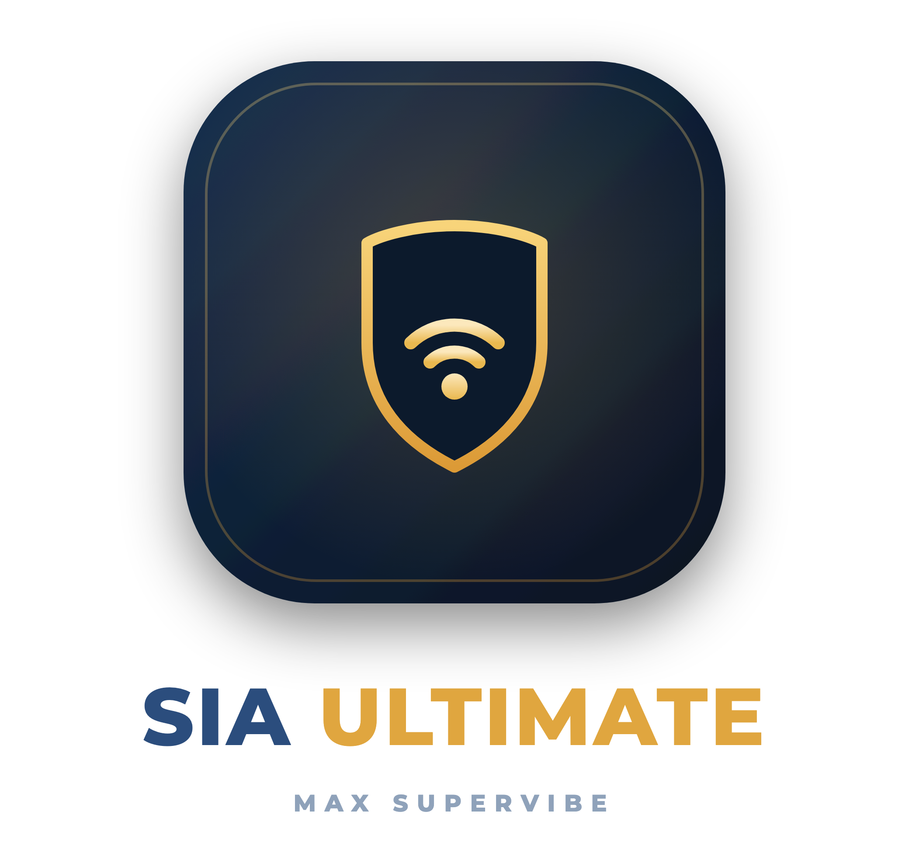

  

## Connect your SIA-DCS compatible alarm system to node-red.

SIA Ultimate connects SIA-DC09 compatible alarm systems, including Ajax Systems, directly to Node-RED. Receive real-time alarm events, monitor security status, and integrate intrusion, fire, and technical alarms into powerful automation workflows, enabling seamless interaction with smart home and building management systems.

 
 
 

[![NPM version][npm-version-image]][npm-url]
[![NPM downloads per month][npm-downloads-month-image]][npm-url]
[![NPM downloads total][npm-downloads-total-image]][npm-url]
[![MIT License][license-image]][license-url]

[![Facebook][facebook-image]][facebook-url]

  

 
 

## 📘 Documentation

The full documentation is on **[maxsupervibe.com](https://www.maxsupervibe.com/docs/sia-ultimate/)**, together with the help of every other Max Supervibe node.

  <a href="https://www.maxsupervibe.com/docs/sia-ultimate/">📘 Go to the documentation</a>

Release notes: [CHANGELOG.md](CHANGELOG.md)

[license-image]: https://img.shields.io/badge/license-MIT-blue.svg
[license-url]: https://github.com/Supergiovane/node-red-contrib-sia-ultimate/master/LICENSE
[npm-url]: https://npmjs.org/package/node-red-contrib-sia-ultimate
[npm-version-image]: https://img.shields.io/npm/v/node-red-contrib-sia-ultimate.svg
[npm-downloads-month-image]: https://img.shields.io/npm/dm/node-red-contrib-sia-ultimate.svg
[npm-downloads-total-image]: https://img.shields.io/npm/dt/node-red-contrib-sia-ultimate.svg
[facebook-image]: https://img.shields.io/badge/Visit%20me-Facebook-blue
[facebook-url]: https://www.facebook.com/supergiovaneDev
